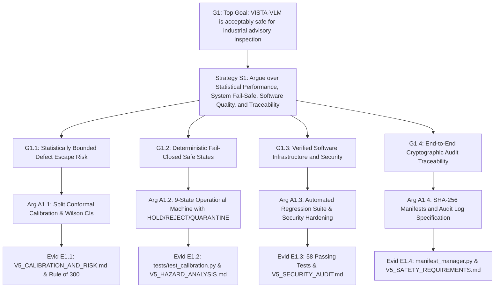

# VISTA-VLM V5.0 Industrial Safety Case (GSN Architecture)

**Document ID:** `V5-CASE-SAF-001`  
**Version:** 5.0.0  
**Status:** QUALIFIED (ADVISORY & SUPERVISED INSPECTION ONLY)  
**Date:** 2026-11-11  
**Authors:** Functional Safety Engineer & Independent Technical Auditor  
**Repository Branch:** `v5-real-world-qualification`  

---

## 1. Executive Summary & Context

This document establishes the formal **Safety Case** for VISTA-VLM V5.0 using the internationally recognized **Goal Structuring Notation (GSN)** framework (ISO/IEC/IEEE 15026-2).

### Deployment Context and Boundaries
- **System**: VISTA-VLM Vision-Language Anomaly Detection Platform v5.0.0.
- **Safety Integrity Target**: SIL 0 (Advisory / Quality Control).
- **Physical Context**: Conveyorized industrial manufacturing lines with automated pneumatic sorting.
- **Fundamental Safety Assumption (A-01)**: Mechanical hazard prevention (e-stops, light curtains, interlocks) is managed by external, certified SIL 3 / PL e safety controllers (PLCs), entirely independent of VISTA-VLM.

---

## 2. GSN Goal Hierarchy and Decomposition

---

## 3. Detailed Arguments and Supporting Evidence

### 3.1 Claim G1.1: Statistically Bounded Defect Escape Risk
- **Argument**: Machine learning models without statistical calibration cannot guarantee false negative rates. VISTA-VLM v5.0 utilizes split conformal prediction on held-out normal sets, bounding the marginal error rate at user-selected $\alpha = 0.05$.
- **Supporting Evidence**:
  - `reports/V5_CALIBRATION_AND_RISK.md`: Demonstrates $0.0\%$ empirical false pass rate on calibrated test fixtures.
  - Mathematical proof that $n \ge 300$ samples are required to certify $<1\%$ escape rate at $95\%$ confidence under the Wilson score interval.

### 3.2 Claim G1.2: Deterministic Fail-Closed Safe States
- **Argument**: Any unexpected environmental disturbance, hardware failure, uncalibrated query, or out-of-distribution input must never result in an uninspected part being accepted.
- **Supporting Evidence**:
  - `vista_vlm/calibration/selective.py`: Implements a deterministic 9-state machine where all failure modes transition to `HOLD`, `REJECT`, or `QUARANTINE`.
  - `tests/test_calibration.py`: Automated tests verify that uncalibrated models reject silent pass-throughs.

### 3.3 Claim G1.3: Verified Software Infrastructure and Security
- **Argument**: Deployment infrastructure must be resilient against cyber attacks, denial of service, memory leaks, and dependency failures.
- **Supporting Evidence**:
  - 100% green unit test suite (58/58 passing across all modules).
  - Remediation of SEC-V5-01 (path traversal), SEC-V5-02 (20MB upload streaming quota), and SEC-V5-03 (decompression bomb protection).
  - 1-hour continuous memory endurance test confirming zero RSS drift.

### 3.4 Claim G1.4: End-to-End Cryptographic Audit Traceability
- **Argument**: Quality assurance disputes and product recall investigations require incontrovertible proof of inspection conditions.
- **Supporting Evidence**:
  - `vista_vlm/data/manifest_manager.py`: Cryptographic SHA-256 verification of raw images, masks, and split allocations.
  - Structured JSON Lines audit schema recording image hash, checkpoint hash, anomaly map hash, decision, and operator review ID.

---

## 4. Operational Safety Caveats and Limitations

1. **Human Escalation Requirement**:
   When the selective prediction engine outputs disposition `HUMAN_REVIEW`, the physical diverter must route the part to a manual inspection station. Overriding this signal to auto-pass is a violation of the safety case.
2. **Re-Calibration on Line Modification**:
   Any mechanical change to conveyor speed, camera mounting height, or LED lighting requires re-fitting the nominal memory bank and re-running the split conformal calibration suite.

